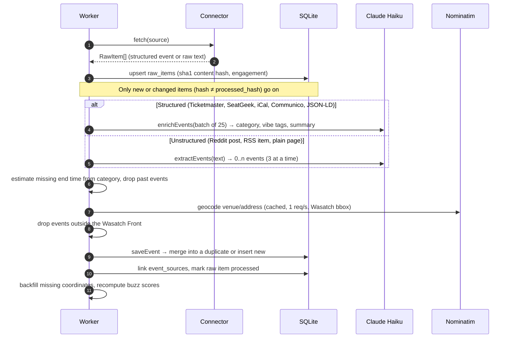
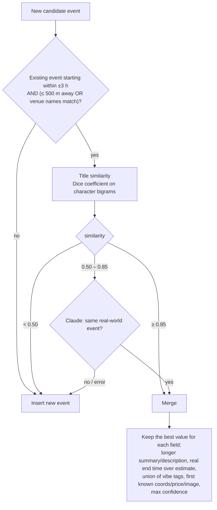
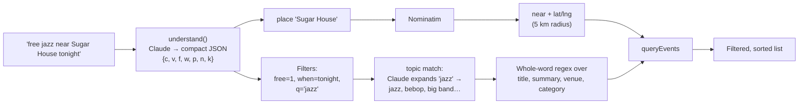
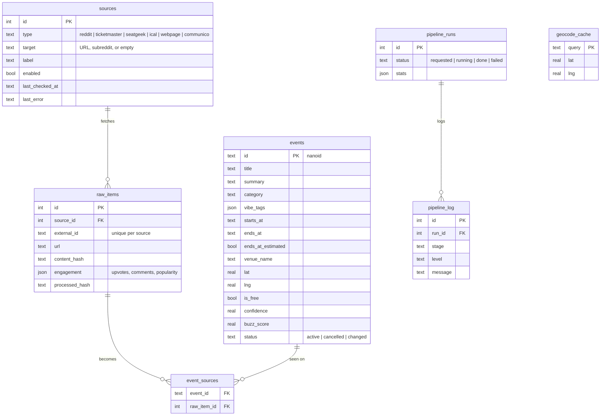

# PullUp

**Open-invite events along Utah's Wasatch Front, all in one place.**

Utah has plenty of free and public events, but they're spread across Reddit threads, library calendars, university feeds and ticketing sites. PullUp runs an AI pipeline that gathers events from all of those, pulls out the details, places them on a map, merges duplicates, and shows the result as one filterable list with a live map and a time slider. Find something, then just pull up.

Built at **Crimson Hacks 2026** (University of Utah). Theme: *State of Utah*.

---

## Contents

- [Features](#features)
- [How it works](#how-it-works)
  - [Architecture](#architecture)
  - [The pipeline](#the-pipeline)
  - [Duplicate merging](#duplicate-merging)
  - [Popularity (buzz score)](#popularity-buzz-score)
  - [Natural-language search](#natural-language-search)
  - [Plan my night](#plan-my-night)
- [Tech stack](#tech-stack)
- [Data model](#data-model)
- [Routes and API](#routes-and-api)
- [Project layout](#project-layout)
- [Running locally](#running-locally)
- [Environment variables](#environment-variables)
- [Scripts](#scripts)
- [Deploying](#deploying)
- [Desk display (ESP32)](#desk-display-esp32)
- [Adding a source](#adding-a-source)

---

## Features

| | |
|---|---|
| **Event list** (`/`) | Upcoming events grouped by day ("Tonight", "Tomorrow", "Sat, Nov 8"). Each card shows the image, time, venue, Free/price, category, vibe tags, Reddit engagement and how many sources list the event. Events at the same venue on the same day are grouped together. |
| **Filters and sort** | Time (now, today, tonight, tomorrow, weekend, week, month), 12 categories, 11 vibe tags, free only. Sort by soonest, most popular, nearest or newest. All filter state lives in the URL, so links can be shared and the back button works. |
| **AI search** | Type something like *"chill free music near Sugar House tonight"*. Claude turns it into filters, which show up as chips you can remove. |
| **Live map** (`/map`) | MapLibre map of the valley with a time scrubber covering the next 7 days in 5-minute steps. Pins appear when an event starts and fade out when it ends, and pins for events happening now pulse. Press play to watch the evening unfold. |
| **Event detail** (`/events/[id]`) | AI summary, full time range ("~ends 10 PM" when the end time is estimated), mini-map, directions, and every source the event was found on. |
| **Venue pages** (`/venues/[venue]`) | Everything happening at one venue on a given day. |
| **Plan my night** (`/plan`) | Describe your night in plain English and get an ordered itinerary of real events with arrival and leave times, drive estimates and backups. |
| **"Maybe" events** | Low-confidence finds (confidence < 0.6) are hidden by default and shown with `?maybe=1`. |
| **Desk display** | An ESP32 board with a small screen that shows the best upcoming event for your interests. See [`device/README.md`](device/README.md). |

---

## How it works

### Architecture

The app runs as two processes that share a single SQLite file: the **Next.js web app**, which reads events and serves the UI and API, and a **pipeline worker**, which does all the scraping and writing. SQLite in WAL mode lets them run side by side safely.

```mermaid
flowchart LR
  subgraph Sources
    R[Reddit<br/>5 subreddits]
    TM[Ticketmaster API]
    SG[SeatGeek API]
    IC[iCal feeds<br/>U of U Trumba]
    CM[Communico<br/>SLC + County libraries]
    WP[Web pages<br/>JSON-LD / text]
  end

  subgraph Worker["Pipeline worker (src/pipeline)"]
    C[Connectors] --> X[AI extract / enrich<br/>Claude Haiku 5.5]
    X --> G[Geocode<br/>Nominatim]
    G --> M[Dedup + merge]
    M --> B[Buzz score]
  end

  subgraph Web["Next.js 16 app"]
    UI[List · Map · Detail · Plan]
    API[/api/*]
  end

  R & TM & SG & IC & CM & WP --> C
  B --> DB[(SQLite<br/>data/pullup.db)]
  DB --> UI
  DB --> API
  API -- "Run now" request --> DB
  DB -- polls requested runs --> C
  ESP[ESP32 desk display] -- GET /api/device --> API
```

- The **worker** (`src/pipeline/worker.ts`) checks for requested runs every 3 seconds and schedules a full run every 3 hours on its own. `npm run pipeline` runs once and exits.
- The **web app** only reads events. Requesting a run (`POST /api/admin/run`) just inserts a `pipeline_runs` row, and the worker picks it up.
- **All filtering and sorting** goes through one function, `queryEvents` in `src/lib/events/query.ts`. The list, map, search, API and planner all use it, so they always agree.

### The pipeline

Each run goes through every enabled row in `sources`:



Key points:

- **Connectors don't use AI and don't write to the database.** Each one returns `RawItem[]`. Structured sources fill in `item.event`, and unstructured sources put readable text in `item.text`. See `src/pipeline/connectors/types.ts`.
- **Re-runs are cheap.** Every raw item gets a SHA-1 content hash. Engagement (upvotes and comments) is refreshed on every run, but AI work only happens when the content has changed.
- **Extraction rules** (`src/pipeline/extract.ts`): an event needs a specific date and has to be open to the public (free, or tickets anyone can buy). Questions, job posts, private gatherings and business hours are dropped. Relative dates like "this Saturday" are resolved against the post date in `America/Denver`. Unknown fields stay `null` and are never made up.
- **Missing end times** are estimated from the category (`DEFAULT_DURATION_MS` in `src/shared/event.ts`) and flagged with `ends_at_estimated`, which the UI shows as "~ends 9 PM".
- **Logging:** every stage (`fetch`, `extract`, `geocode`, `merge`, `run`) writes to `pipeline_log`. `GET /api/admin/stream` streams that log over Server-Sent Events.

### Duplicate merging

The same concert often shows up on Ticketmaster, SeatGeek and a Reddit post. `saveEvent` in `src/pipeline/merge.ts` handles this in three stages:



Every source that contributed stays linked in `event_sources`, which is where the "seen on N sources" badge comes from.

### Popularity (buzz score)

`recomputeBuzz` gives each event a `buzz_score` from 0 to 100. That score is the event's best percentile within its source type, using Reddit upvotes + 2 × comments, or SeatGeek popularity. Sources that don't report engagement don't contribute, so an event with no data gets no score rather than a fake 0. The score drives the "popular" sort and the hot / popular / quiet tiers.

### Natural-language search



- `src/lib/search/understand.ts` maps the query to a reply with one-letter keys (about 15–25 output tokens) and caches it in memory, so repeated searches cost nothing.
- `src/lib/search/topic.ts` has Claude expand topic words into a few related terms. The matching itself happens in plain code, so each new topic costs one tiny API call no matter how many events there are.
- **It still works without AI.** If Claude is unavailable, the search text is used as plain keywords and the response carries `ai: false`.

### Plan my night

`src/lib/plan/plan.ts` turns a request like *"dinner-ish thing then live music, free after 7, near downtown"* into an itinerary in four steps:

1. **Understand.** Claude pulls out the date, a time window, interests, categories, vibe tags, a free-only flag, a place and the number of stops. Without AI it falls back to tonight and uses the text as keywords.
2. **Shortlist.** Every event that overlaps the window by at least 40 minutes (and is within 25 km of the place, if one was named), ranked by topic match. The top 28 go to the next step.
3. **Compose.** Claude picks 1–4 stops in order, with arrive and leave times and a reason for each, plus backups.
4. **Check.** The server adjusts times to fit the events and the window, removes overlaps, adds drive estimates and flags tight connections. If AI isn't available, a greedy scheduler builds the plan instead.

---

## Tech stack

| Layer | Choice |
|---|---|
| Language | TypeScript, end to end |
| Framework | **Next.js 16** (App Router, React Server Components, Turbopack) · **React 19** |
| Styling / UI | **Tailwind CSS 4** · **shadcn/ui** on Radix · lucide-react icons · tw-animate-css · light/dark theme |
| Database | **SQLite** via `better-sqlite3` (WAL mode) · **Drizzle ORM** + drizzle-kit migrations |
| AI | **Claude Haiku 5.5** (`claude-haiku-5-5`) via `@anthropic-ai/sdk`, used for extraction, enrichment, dedup tie-breaks, search and planning. Thinking is off and prompts are kept short; replies are JSON validated with **zod** (one retry on a malformed reply) |
| Maps | **MapLibre GL** with **OpenFreeMap** tiles (no API key) |
| Geocoding | **OpenStreetMap Nominatim**, cached forever in SQLite, 1 request/second, limited to the Wasatch Front bounding box |
| Scraping | `cheerio` (HTML + schema.org JSON-LD), `node-ical` (iCal + RRULE), Reddit OAuth or public Atom feed, Ticketmaster Discovery API, SeatGeek API, Communico JSON |
| Dates | `date-fns` + `@date-fns/tz`; everything is resolved in `America/Denver` |
| Concurrency | `p-limit` for AI calls · `concurrently` to run web and worker together |
| Hardware | ESP32-C3 + ST7789 LCD (Arduino, Adafruit GFX, ArduinoJson) |
| Hosting | One Railway service (web + worker) with a persistent volume mounted at `/data` |

---

## Data model



**Categories:** Music · Outdoors · Climbing · Running & Fitness · Food & Drink · Arts & Culture · Community · Sports · Nightlife · Markets · Learning & Talks · Family

**Vibe tags:** free · beginner-friendly · meet-people · go-solo · family-friendly · 21+ · dog-friendly · outdoorsy · chill · high-energy · student

The schema lives in `src/lib/db/schema.ts`, and migrations live in `drizzle/`. They run automatically when the app or worker starts.

---

## Routes and API

**Pages**

| Route | |
|---|---|
| `/` | Event list with filters and search |
| `/map` | Live map with time scrubber |
| `/events/[id]` | Event detail |
| `/venues/[venue]` | One venue's events on a given day |
| `/plan` | Plan my night |

**API**

| Endpoint | |
|---|---|
| `GET /api/events?when=&cat=&vibe=&free=&sort=&lat=&lng=&maybe=` | Filtered, sorted events. Takes the same params as the page URLs |
| `POST /api/search` `{ q }` | Natural-language query → `{ filters, nearMe, ai }` |
| `POST /api/plan` `{ text }` | Night description → itinerary (`NightPlan`) |
| `GET /api/device?for=<interests>&when=week` | Up to 8 picks as short ASCII strings for the desk display (cached 5 min) |
| `POST /api/admin/run?secret=…` | Queue a pipeline run |
| `GET /api/admin/stream?secret=…` | SSE stream of `pipeline_log` rows and run status |
| `POST /api/admin/import` (header `x-admin-secret`) | Replace sources and events with an uploaded SQLite snapshot |

Admin endpoints return `404` unless the secret matches `ADMIN_SECRET` (checked in constant time).

---

## Project layout

```
src/
  app/                    Next.js routes: pages + /api route handlers
  components/
    events/               cards, filter bar, event map, thumbnails
    map/                  live map, canvas, time scrubber, map filters
    plan/                 night planner UI
    ui/                   shadcn/ui primitives
  lib/
    ai/                   claude.ts (Haiku client), llm.ts (typed JSON generation)
    db/                   Drizzle schema, SQLite client, snapshot export/import
    events/               query.ts (the single filter/sort module), filters, formatting, grouping, popularity
    geo/                  Nominatim geocoding, region check, distances
    search/               understand.ts (NL → filters), topic.ts (term expansion)
    plan/                 Plan my night
  pipeline/
    connectors/           one adapter per source type + registry (index.ts)
    run.ts                orchestrator: fetch → extract → geocode → merge → buzz
    extract.ts            AI extraction / enrichment
    merge.ts              3-stage dedup
    worker.ts             long-running worker / one-shot runner
  shared/                 event types, categories, vibe tags (zod), Utah time helpers
scripts/                  seed sources, demo data, manual events, snapshot
drizzle/                  SQL migrations
device/                   ESP32 desk display firmware
```

---

## Running locally

Requires **Node.js 22.9 or newer**.

```bash
npm install
```

```bash
cp .env.example .env.local
```

Fill in the keys (see [Environment variables](#environment-variables)), then:

```bash
npm run seed
```

```bash
npm run pipeline
```

```bash
npm run dev
```

`npm run seed` adds the starting sources, `npm run pipeline` runs one full scrape into `data/pullup.db`, and `npm run dev` starts the web app and the background worker at http://localhost:3000.

No keys yet? `npm run seed:demo` fills the database with sample events that are clearly labelled, so you can work on the UI. Remove them with `npm run seed:demo -- --clear`.

---

## Environment variables

| Variable | Required | Where to get it |
|---|---|---|
| `ANTHROPIC_API_KEY` | Recommended | [platform.claude.com](https://platform.claude.com) → API Keys. Without it, search and planning fall back to keyword matching and unstructured sources can't be extracted |
| `TICKETMASTER_API_KEY` | Optional | [developer.ticketmaster.com](https://developer-acct.ticketmaster.com/user/register) → My Apps → Consumer Key |
| `SEATGEEK_CLIENT_ID` | Optional | [seatgeek.com/account/develop](https://seatgeek.com/account/develop) → Create New App |
| `REDDIT_CLIENT_ID` / `REDDIT_CLIENT_SECRET` / `REDDIT_USERNAME` | Optional | [reddit.com/prefs/apps](https://www.reddit.com/prefs/apps) → "script" app. Without them the public Atom feed is used (no vote counts) |
| `ADMIN_SECRET` | Yes | Any long random string; protects `/api/admin/*` |
| `APP_URL` | Yes | Public URL, used in the Nominatim/Reddit User-Agent |
| `DATABASE_PATH` | No | Defaults to `./data/pullup.db`; set to `/data/pullup.db` on Railway |

OpenFreeMap, Nominatim and the library and university feeds don't need keys.

---

## Scripts

| Command | What it does |
|---|---|
| `npm run dev` | Web app + worker (`concurrently`) |
| `npm run dev:web` | Web app only |
| `npm run build` / `npm start` | Production build; `start` seeds sources, then runs web + worker |
| `npm run pipeline` | One full pipeline run, then exit. Limit it with `-- --sources=14,15` |
| `npm run worker` | Long-running worker only |
| `npm run seed` | Add or refresh the starting source list (idempotent) |
| `npm run seed:demo` | Load sample events for UI work (`-- --clear` to remove) |
| `npx tsx --env-file-if-exists=.env.local scripts/add-manual-events.ts` | Add hand-picked events for categories the scrapers cover thinly |
| `npm run snapshot` | Export local events to `data/pullup-snapshot.db` |
| `npm run db:generate` | Generate a Drizzle migration after schema changes |
| `npm run lint` / `npm run typecheck` | ESLint / `tsc --noEmit` |

---

## Deploying

PullUp runs as **one Railway service**: `npm start` runs `next start` and the worker together, with a volume mounted at `/data` and `DATABASE_PATH=/data/pullup.db`. Set the same variables as in `.env.local`, plus `NODE_ENV=production`.

Event data never goes in git. To copy your local events to a deployment:

```bash
npm run snapshot
```

```bash
curl -X POST -H "x-admin-secret: $ADMIN_SECRET" -H "Content-Type: application/octet-stream" --data-binary @data/pullup-snapshot.db https://<your-domain>/api/admin/import
```

This replaces the deployment's sources and events but keeps its pipeline logs. From then on, the deployment's worker keeps the events up to date.

---

## Desk display (ESP32)

A Waveshare ESP32-C3-LCD-1.47 that shows the best upcoming event for your interests, with a live countdown, and an LED that glows while the event is happening. It calls `GET /api/device`, which uses the same AI search as the site. Wiring, flashing and configuration are in [`device/README.md`](device/README.md).

---

## Adding a source

- **A new website or feed of a type that's already supported:** add a `sources` row (see `scripts/seed-sources.ts`). No code changes needed.
- **A new source type:** write one connector file in `src/pipeline/connectors/` that implements `Connector`, add it to the registry in `connectors/index.ts`, and add the type to `SOURCE_TYPES` in `src/shared/event.ts`.

Starting sources: Ticketmaster and SeatGeek (within 60 miles of SLC), r/SaltLakeCity, r/Utah, r/slc, r/uofu, r/Provo, Visit Salt Lake events, the University of Utah Trumba calendar, Salt Lake City Public Library and Salt Lake County Library.
